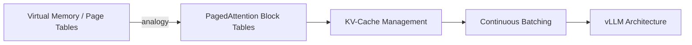

# ai-infra-notes

Personal, structured learning notes for the **AI Infra / LLM Inference** study path
(Nov 2026 → Mar 2027 internship cycle). Organized by module, with the key concept
**"OS → PagedAttention"** mapping drawn explicitly.

> Constantly updated; used both as my own study tracker and as interview-prep review.

## Modules

- **OS / Memory → PagedAttention**: virtual memory, paging, page tables, TLB →
  how Block Tables map KV cache in vLLM. *(drawing the OS→PagedAttention map)*
- **GPU / CUDA**: thread/block/warp, memory hierarchy, shared memory & bank
  conflicts, coalescing, occupancy, Nsight Compute.
- **LLM Inference**: KV cache, Prefill vs. Decode, PagedAttention, Continuous
  Batching, FlashAttention, quantization (AWQ/GPTQ), serving metrics.
- **Distributed**: collectives, Ring AllReduce, Tensor/Data/Pipeline parallelism,
  NCCL, RDMA/NVLink basics.
- **Interview Prep**: interview Q&A notes (八股), whiteboard list.

## Key Maps



## Roadmap (Nov → Mar)

| Month | Focus | Output |
|-------|-------|--------|
| Nov | OS/GPU fundamentals, minimal Transformer, CUDA warm-up | OS→PagedAttention map, minimal decoder |
| Dec | inference optimization, nano-vllm source | quant benchmark, vLLM dev |
| Jan | CUDA/Triton kernels, distributed parallel | SGEMM opt, 2-GPU TP |
| Feb | whiteboard GQA, project polish, resume | English READMEs, interview prep |
| Mar | job applications | 15+ applications |

## Blog (mirror)

Long-form English posts live on [wyh1309.github.io](https://wyh1309.github.io);
this repo keeps the working notes and drafts.

## Layout

```
os-pagedattention/   the virtual-memory → PagedAttention mapping notes
gpu-cuda/            GPU architecture + CUDA notes
inference/           KV cache, batching, quantization notes
distributed/         parallelism + NCCL notes
interview/           Q&A and whiteboard prep
```
